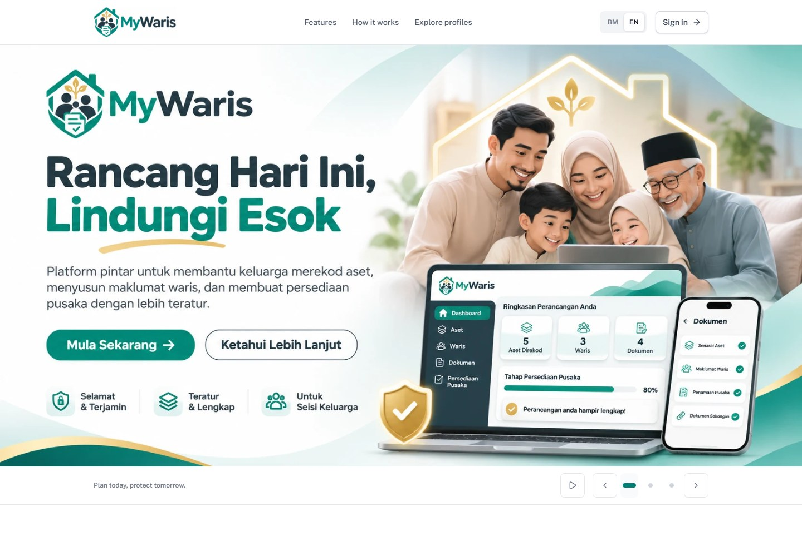
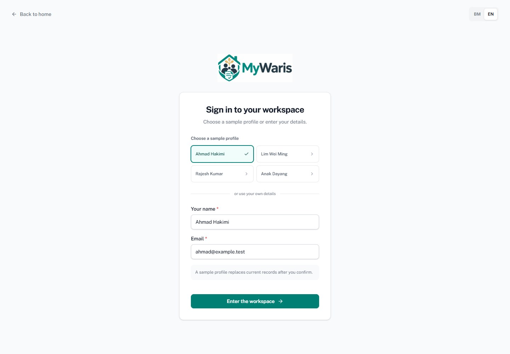
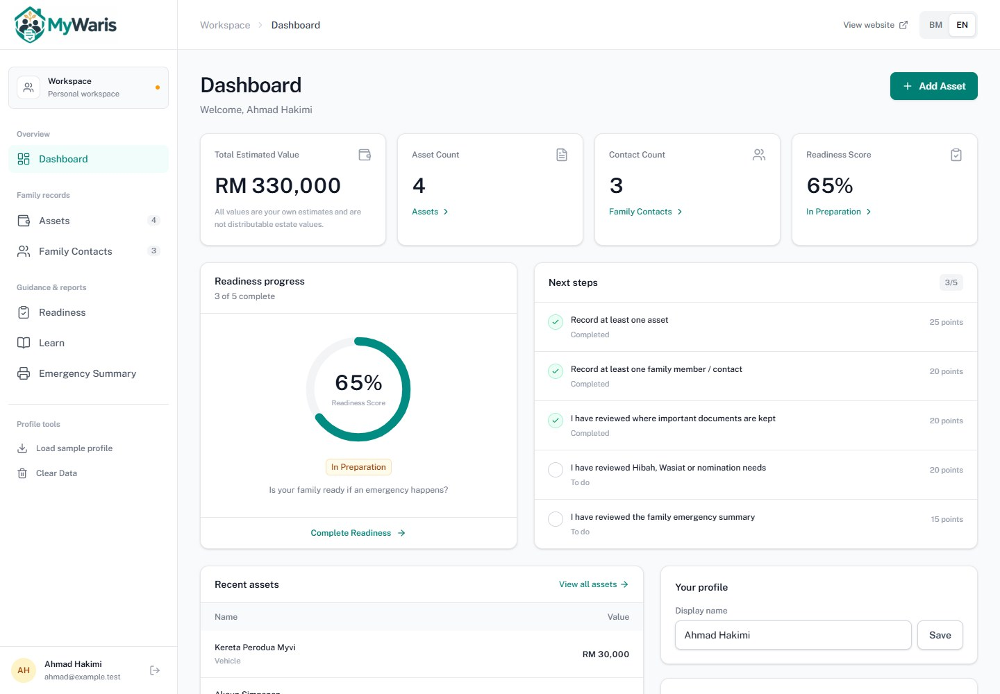
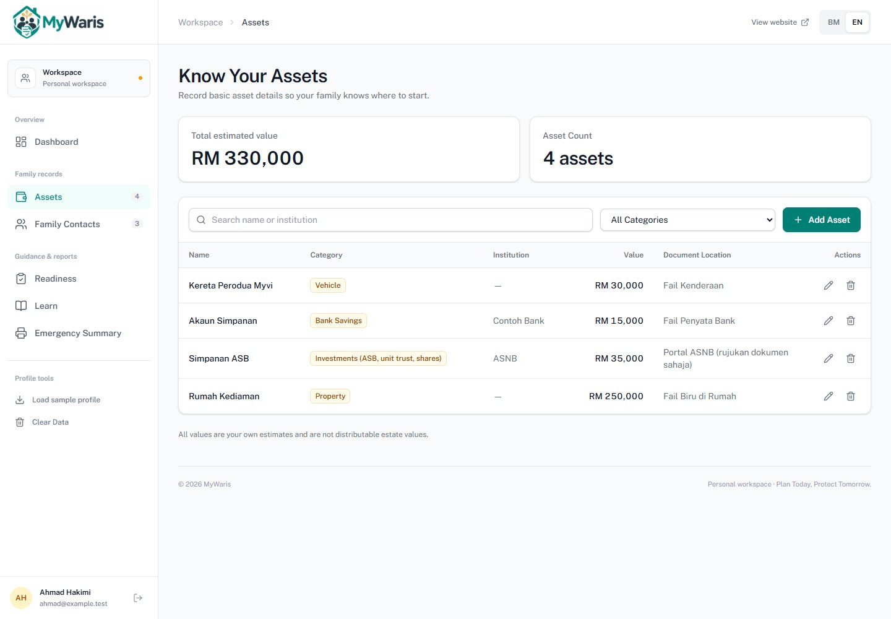
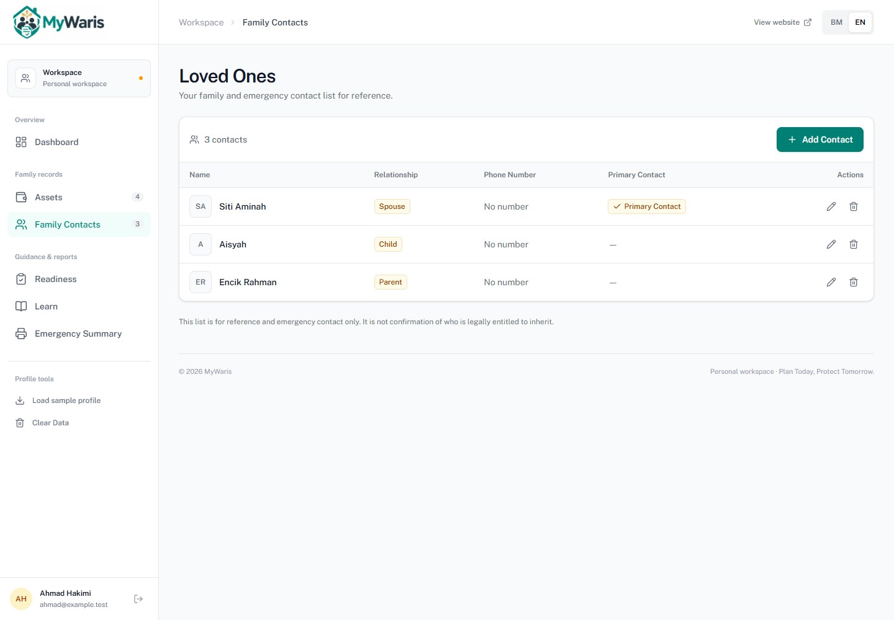
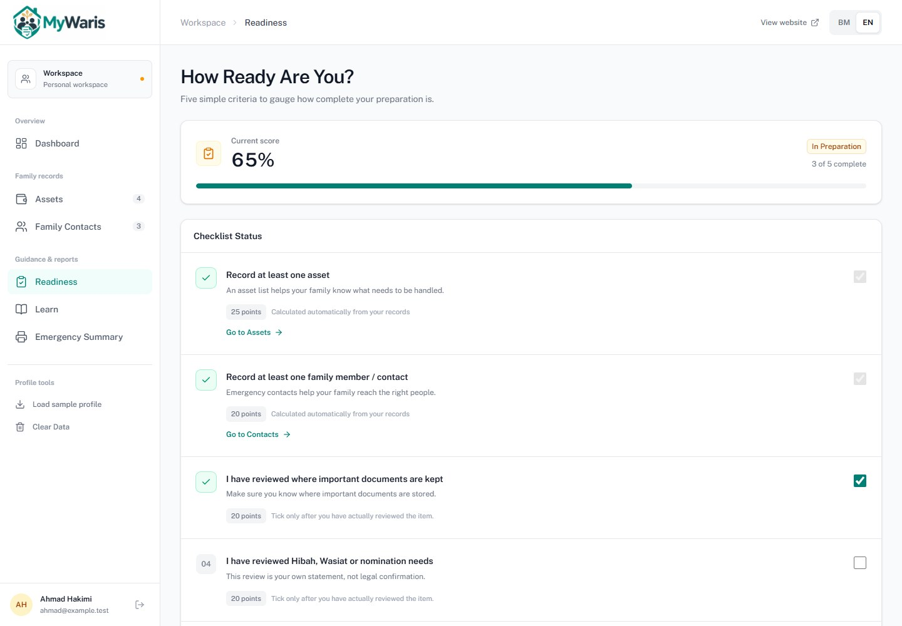
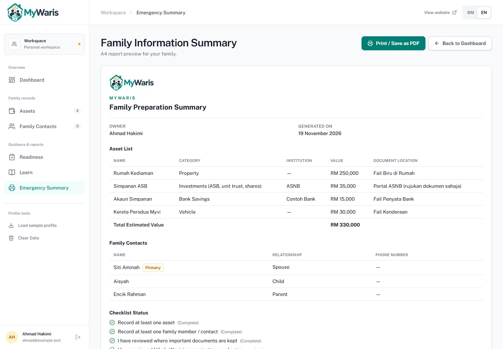
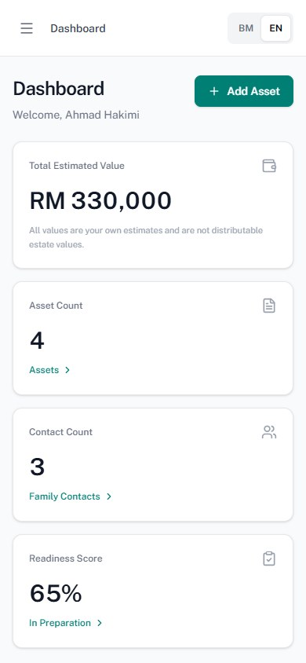

# MyWaris

**Rancang Hari Ini, Lindungi Esok.**

> [!IMPORTANT]
> **Live website: [https://mywaris.vercel.app/](https://mywaris.vercel.app/)**

MyWaris helps Malaysian families organise asset records, family contacts, and inheritance-readiness information in one workspace. It includes Bahasa Melayu and English interfaces, a readiness checklist, and a printable family emergency summary.

The project retains the `warisready` package and storage names. The interface uses Filament-inspired React components, not the Laravel Filament library.

## Features

- Branded landing page with a three-image carousel, playback controls, keyboard navigation, and reduced-motion support.
- Workspace entry with name/email details or four sample profiles.
- Dashboard showing asset totals, contact counts, readiness progress, and next steps.
- Asset creation, editing, deletion, search, and category filtering.
- Family-contact management with an optional phone number and a single primary contact.
- Readiness checklist and an A4-friendly emergency summary that can be printed or saved as PDF through the browser.
- Responsive navigation, confirmation dialogs, and persistent language selection.

Detailed inheritance-learning content is still in development. The sample profiles cover Muslim, non-Muslim civil, and Sabah/Sarawak native-customary contexts; they do not provide legal calculations or personalised legal advice.

## System screenshots

Screenshots of the MyWaris interface using the built-in Ahmad sample profile. Select an image to view it at full size.

### Landing page

[](docs/screenshots/landing.jpg)

### Workspace

| Workspace entry | Dashboard |
| --- | --- |
| [](docs/screenshots/login.jpg) | [](docs/screenshots/dashboard.jpg) |

| Asset management | Family contacts |
| --- | --- |
| [](docs/screenshots/assets.jpg) | [](docs/screenshots/family.jpg) |

| Readiness checklist | Emergency summary |
| --- | --- |
| [](docs/screenshots/readiness.jpg) | [](docs/screenshots/summary.jpg) |

### Mobile view

<a href="docs/screenshots/mobile.jpg"></a>

## Current architecture and limitations

| Component | Status |
| --- | --- |
| React frontend | Working interface; profile records persist in `localStorage` |
| Workspace entry | Client-side session only; not real authentication or account isolation |
| Express API | Separate local API with profile, asset, contact, import, and reset endpoints |
| Database | MariaDB/MySQL schema, migration runner, and seed scripts are included |
| Frontend-to-API integration | Not connected yet; starting the API does not change frontend persistence |
| Production deployment | Requires hosting configuration; multi-user use also needs authentication and data isolation |

Different sign-in details in the same browser do not create separate profiles. Clearing site storage can remove saved records. Use sample information until authentication, server persistence, and appropriate privacy controls are implemented.

## Technology

| Layer | Stack |
| --- | --- |
| Frontend | React 19, TypeScript, Vite 8 |
| Interface | Tailwind CSS 4, Lucide icons, React Router 7 |
| Backend | Node.js, Express 5, `mysql2` |
| Database | MariaDB 10.4+ / MySQL-compatible server |
| Backend safeguards | Helmet, CORS configuration, rate limiting, validation, structured logs |
| Backend tests | Node.js test runner and Supertest |

## Run the frontend

Use Node.js 24 and npm. The frontend can run independently of the API and database.

The redesigned interface is available on the `jiji` branch:

```bash
git clone --branch jiji https://github.com/justlittleslaive/WARIS.git
cd WARIS
npm ci
npm run dev
```

Open **http://127.0.0.1:5173**. The development server uses a strict port, so stop an existing server on that port or reuse it rather than starting another copy.

For a production build and local preview:

```bash
npm run build
npm run preview
```

`npm run build` performs TypeScript checking and writes the static application to `dist/`. Preview is for local verification, not production hosting.

### Frontend scripts

| Command | Purpose |
| --- | --- |
| `npm run dev` | Start the Vite development server |
| `npm run build` | Type-check and build the application |
| `npm run preview` | Preview the production build locally |

There is currently no frontend automated-test script in the root package. Changes to interactive features should also be checked in a browser.

## Optional backend and database

The backend is a separate Node.js application. A fresh clone does not contain a database installation, credentials, or the local database data directory.

1. Provision a dedicated MariaDB instance. The local development configuration uses port **3308**; do not reuse or modify the separate XAMPP instance on port **3307**.
2. Create the `warisready` and `warisready_test` databases and an application database user. Follow the SQL setup in [backend/README.md](backend/README.md).
3. Install and configure the API from the repository root:

```bash
cd backend
npm ci
cp .env.example .env
```

Edit `.env` to match your database connection. Replace the `change-me` password with your own value before continuing. Then run:

```bash
npm run db:setup
npm start
```

`db:setup` applies pending migrations and ensures the singleton profile exists; it does not populate the four frontend sample personas.

Check the API and database connection:

```bash
curl http://127.0.0.1:4000/api/health
```

A healthy response is:

```json
{"status":"ok","database":"up"}
```

### Backend scripts

Run these commands from `backend/`:

| Command | Purpose |
| --- | --- |
| `npm start` | Start the API |
| `npm run dev` | Start the API in watch mode |
| `npm run db:migrate` | Apply pending SQL migrations |
| `npm run db:seed` | Ensure the singleton profile exists |
| `npm run db:setup` | Run migrations and seed |
| `npm test` | Run integration tests against the configured test database |

**Test warning:** the backend tests drop and recreate tables in `TEST_DB_NAME`. Use a dedicated disposable test database, never a production database.

See [backend/README.md](backend/README.md) for environment variables, API routes, import behaviour, backups, and operational guidance.

## Application routes

| Route | Page |
| --- | --- |
| `/` | Landing page |
| `/login` | Workspace entry and sample-profile selection |
| `/app` | Dashboard |
| `/app/assets` | Asset records |
| `/app/family` | Family contacts |
| `/app/readiness` | Readiness checklist |
| `/app/learn` | Learning section, currently a placeholder |
| `/app/summary` | Printable emergency summary |

Workspace routes require the client-side session. This navigation guard does not secure the separate backend API.

## Readiness score

| Criterion | Points | Completion |
| --- | --- | --- |
| At least one asset recorded | 25 | Automatic |
| At least one family contact recorded | 20 | Automatic |
| Document preparation | 20 | User checked |
| Inheritance planning | 20 | User checked |
| Emergency-summary review | 15 | User checked |

The total is 100 points. It is an organisational checklist, not a legal assessment or a guarantee that an estate plan is complete.

## Project layout

```text
public/images/       MyWaris logo and landing-page banners
src/components/      Shared controls, dialogs, layout, and carousel
src/context/         Profile, session, and toast state
src/data/            BM/EN translations and sample profiles
src/lib/             Persistence, formatting, validation, and selectors
src/pages/           Public pages and workspace screens
backend/migrations/  SQL schema migrations
backend/src/         Express API, database access, and CLI scripts
backend/test/        API integration tests
```

## Deployment requirements

For static frontend hosting, use `npm ci`, build with `npm run build`, and publish `dist/`. Configure the host to serve `index.html` for application routes such as `/app/assets`, while preserving requests for actual static files. These settings apply to hosts such as Vercel; no live deployment is implied by this README.

The Express API and database are not bundled into the static frontend. Deploy them separately to suitable Node.js and database services. Before enabling real multi-user use:

- Connect the frontend to the API.
- Implement authentication, authorisation, and per-user data isolation.
- Configure HTTPS and the API's allowed frontend origins.
- Set up database backups and operational monitoring.
- Keep credentials in server-side environment settings. Never commit `.env`, database data, or API keys, and never place secrets in client-side code or `VITE_` variables.

## Legal notice and license

MyWaris is not legal advice. Consult a qualified adviser before making inheritance decisions.

Licensed under the [MIT License](LICENSE).
